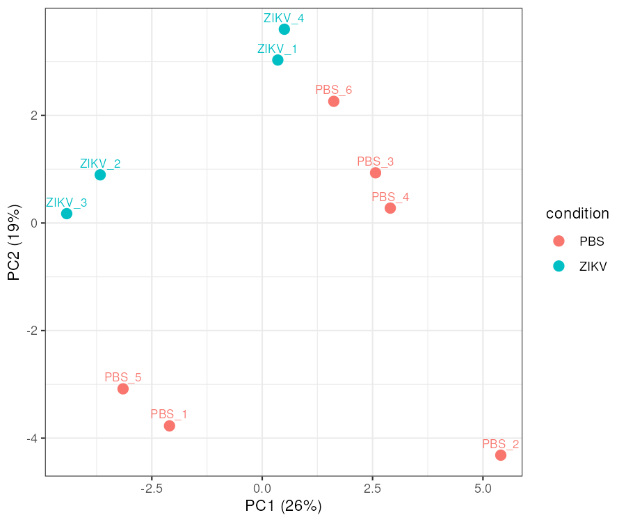
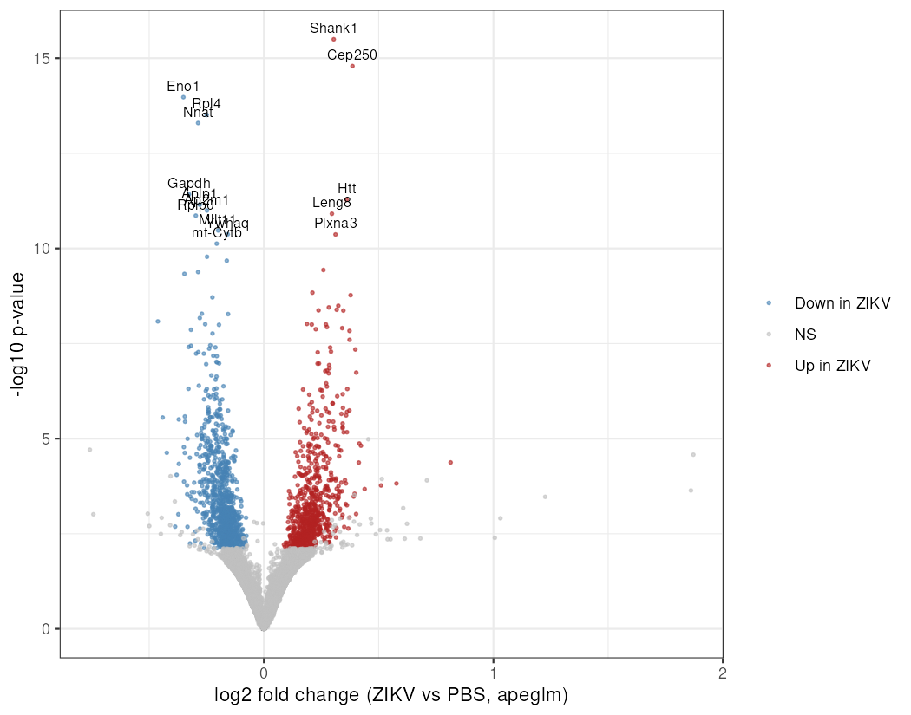
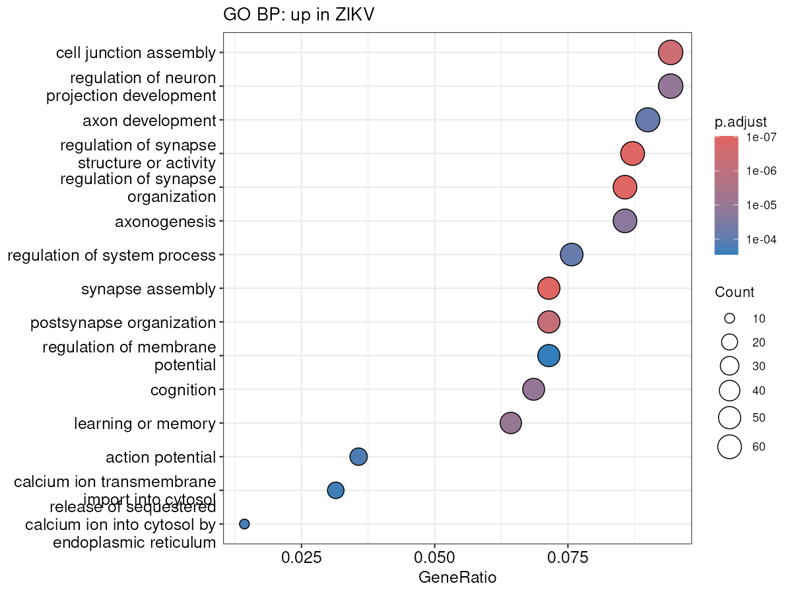
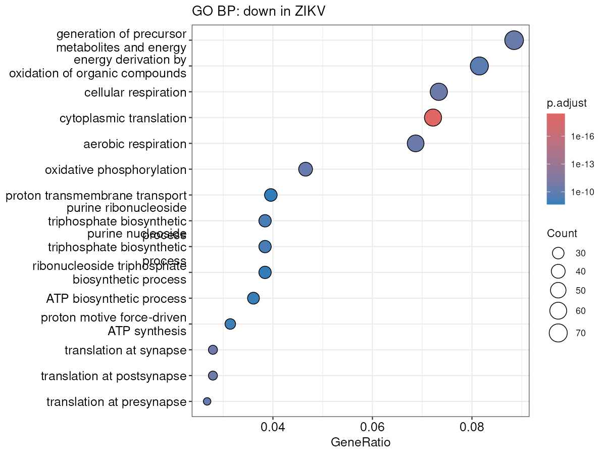

# Nextflow RNA-seq: maternal ZIKV vs PBS, fetal mouse brain (GSE302948)

A containerized Nextflow DSL2 pipeline for paired-end bulk RNA-seq, applied to fetal brains (E18.5)
from dams with an inapparent Zika virus infection versus PBS controls.

**Pipeline:** SRA download → FastQC → fastp → FastQC (trimmed) → Salmon → MultiQC → tximport → DESeq2
**Downstream:** figures, GO enrichment and robustness checks (`analysis/`)

| | |
|---|---|
| Dataset | [GSE302948](https://www.ncbi.nlm.nih.gov/geo/query/acc.cgi?acc=GSE302948), mouse fetal brain, E18.5 |
| Design | 4 ZIKV vs 6 PBS, Illumina 2×150 bp, unstranded |
| Reference | GRCm39, Ensembl release 116 (cDNA) |
| Workflow | Nextflow 26.10, DSL2, every process in a pinned container |
| R image | `ghcr.io/geethcodes/rnaseq-r`, built from `Dockerfile` by GitHub Actions |

## How to run
Requirements: Nextflow ≥ 24 and Apptainer (or Docker).
Reference files expected in `data/reference/`: `Mus_musculus.GRCm39.cdna.all.fa.gz` and `tx2gene.tsv`.

    nextflow run main.nf -profile apptainer

Samples are listed in `metadata/samplesheet.csv` (sample, SRA accession, condition).

Downstream analysis, run in the same R image:

    apptainer exec --bind $PWD rnaseq-r_1.1.0.sif Rscript analysis/interpret.R
    apptainer exec --bind $PWD rnaseq-r_1.1.0.sif Rscript analysis/robustness.R

## Quality control
All 10 samples pass QC and the two groups are technically balanced:

| Metric | Range |
|---|---|
| Read pairs after trimming | 18.6–22.8 M |
| Reads retained by fastp | 98.5–98.9% |
| Bases ≥ Q30 | 90.6–91.4% |
| Salmon mapping rate | 83.7–86.1% |
| GC content | 50.5–50.9% |

Full report: [`docs/multiqc_report.html`](docs/multiqc_report.html)

## Results
| | |
|---|---|
| Genes tested | 10,645 |
| Differentially expressed (padj < 0.05) | **1,616** (714 up, 902 down in ZIKV) |
| With \|shrunken log2FC\| > 1 | **0** (median \|log2FC\| ≈ 0.19, about a 14% change) |

| PCA | Volcano |
|---|---|
|  |  |

| GO BP: up in ZIKV | GO BP: down in ZIKV |
|---|---|
|  |  |

Full tables: [`docs/tables/`](docs/tables/)

### Robustness checks
| Model | Significant* | Shared with main model | log2FC correlation |
|---|---|---|---|
| `~ condition` (main) | 1,601 | n/a | n/a |
| `~ sex + condition` | 1,257 | 1,229 | 0.956 |
| Without outlier PBS_2 | 1,531 | 1,380 | 0.964 |

\*DESeq2 default independent filtering (alpha = 0.1), so the main count differs slightly from 1,616 (alpha = 0.05).
Fetal sex was assigned from Y-chromosome genes (Ddx3y, Eif2s3y, Kdm5d, Uty): PBS 4F/2M, ZIKV 2F/2M.

## Interpretation
- **Small, widespread and robust changes.** About 1,600 genes shift, none by 2-fold or more. The effect
  holds after adjusting for sex and after removing the outlier sample.
- **Sex and infection are separate axes of variation.** PC1 (26%) separates male from female fetuses;
  PC2 (19%) separates ZIKV from PBS within each sex.
- **No active infection signature in the fetal brain.** Interferon-stimulated genes (Ifit1, Isg15, Irf7,
  Stat1) and glial activation markers (Gfap, Aif1) are unchanged, consistent with an inapparent infection.
- **Up in ZIKV:** synapse organization and assembly, axonogenesis, calcium signalling
  (Shank1, Htt, Cacna1c, Plxna3).
- **Down in ZIKV:** cytoplasmic translation (ribosomal proteins), oxidative phosphorylation, glycolysis.
- **Comparison with the original study** (Chou et al., *PLoS Pathogens* 2026): the authors report changes in
  synaptic and neuronal-development genes in the fetal brain and increased synaptic density in offspring.
  The synapse-related terms enriched among up-regulated genes here are consistent with that finding.

## Limitations
- **Gene-length bias.** log2 fold change correlates with transcript length (Spearman ρ = 0.41): long genes
  tend to go up and short genes down. This can arise from RNA-integrity or library differences, or from
  changes in cell-type composition, not only from transcriptional change. The GO themes should be treated
  as hypotheses.
- n = 4 vs 6. Pups from the same dam are not independent, and litter was not modelled.
- The Salmon index is cDNA-only, so non-coding genes (e.g. Xist) are not quantified.
- Salmon `--gcBias --seqBias` makes full reruns differ slightly (1,592 vs 1,616 significant genes).

## Repository layout
    main.nf                    Nextflow pipeline
    nextflow.config            profiles (apptainer)
    Dockerfile                 R image for tximport, DESeq2, GO
    .github/workflows/         builds and publishes the R image
    scripts/                   tximport.R, deseq2.R (run inside the pipeline)
    analysis/                  interpret.R (figures, GO), robustness.R (sex, outlier, length checks)
    metadata/samplesheet.csv   sample → SRA accession → condition
    docs/                      figures, MultiQC report, result tables
